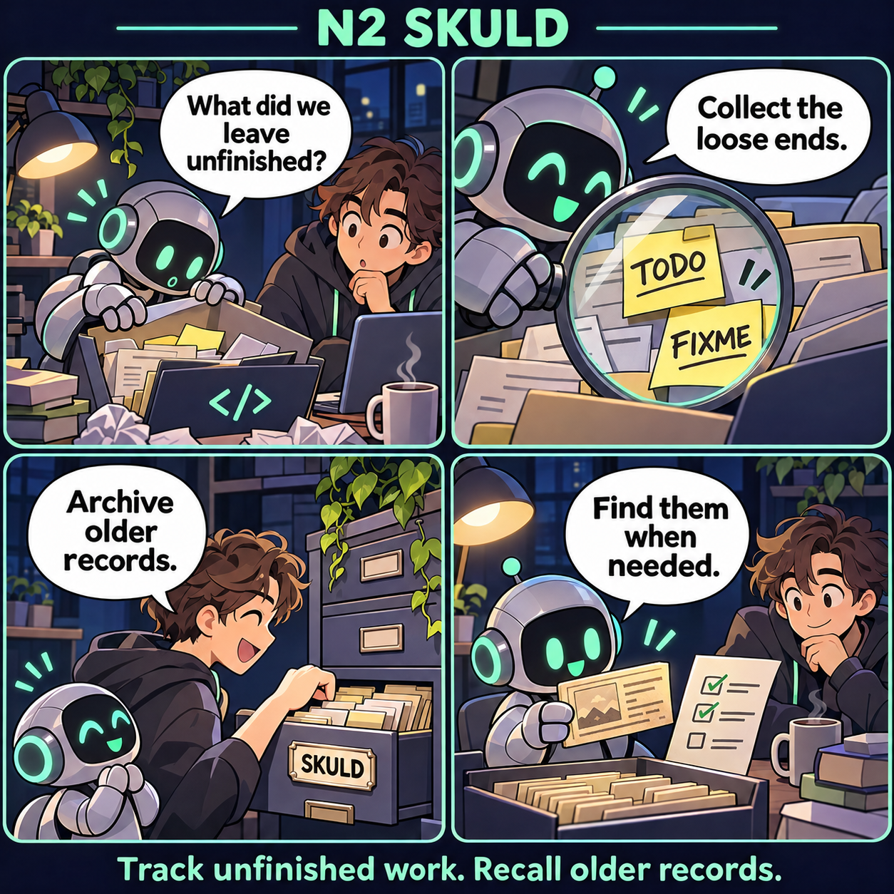
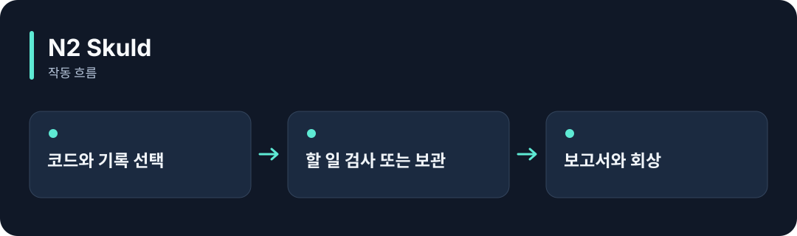

# N2 Skuld

**코드에 남은 할 일을 찾고, 오래된 경험을 보관하고 다시 꺼내볼 수 있게 합니다.**

[](https://github.com/choihyunsus/n2-skuld/releases/tag/v1.0.0) [](https://github.com/choihyunsus/n2-skuld/blob/main/docs/reference.ko.md) [](https://github.com/choihyunsus/n2-skuld/blob/main/LICENSE)

[English](README.md)

<p align="center">
  
</p>

코드에 남은 할 일을 찾고 목록으로 확인합니다. 별도 보관 기능으로 오래된 경험을 보관하고 다시 찾을 수도 있습니다.

기능을 이야기로 표현한 만화입니다. 실제 앱 화면은 아닙니다.

<details>
<summary>동작 흐름 펼쳐 보기</summary>



</details>

## 이런 때 사용하세요

TODO·FIXME를 모아 정리하거나, AI 기억 저장소의 오래된 기록을 별도 보관할 때 사용하세요.

코드 검사와 기억 보관은 각각 호출하는 기능입니다. 보관 작업은 선택한 프로젝트와 에이전트에 적용되므로, 실제 DB를 관리하기 전 백업을 준비하세요.

## 처음 실행하기

Rust 1.98 이상과 C/C++ 빌드 도구를 준비하세요. Windows에서는 Visual Studio C++ Build Tools가 필요합니다. 터미널에서 다음 명령으로 설치합니다.

```sh
cargo install --git https://github.com/choihyunsus/n2-skuld --tag v1.0.0 --locked
```

검사할 소스 폴더를 지정하세요. 첫 예제는 파일의 할 일 표시를 읽습니다.

```sh
n2-skuld scan ./src --project demo --agent assistant
```

`report.complete`가 `true`이면 선택한 범위의 검사가 끝났습니다. `findings`에서 TODO·FIXME 등의 위치를 확인하세요. 기억 보관과 회상 명령은 아래 상세 안내에 따로 설명되어 있습니다.

## Soul과 함께 쓰기

여러 N2 모듈을 연결할 때 같은 `mimir.db` 파일을 지정하세요. `project`는 작업 이름, `agent`는 계속 사용할 AI 이름입니다. 같은 작업의 기록을 이어 쓰려면 이 값들을 맞춥니다. 단독 사용도 같은 필드 구조를 사용합니다.

## 다음 단계와 상세 안내

[전체 사용 안내](https://github.com/choihyunsus/n2-skuld/blob/main/docs/reference.ko.md)에서 실제 앱 연결, API, 지원 범위, 복구 절차와 검증 범위를 확인할 수 있습니다. [배포 파일](https://github.com/choihyunsus/n2-skuld/releases/tag/v1.0.0)에는 설치할 버전과 변경 설명이 있습니다.

처음 나오는 용어는 이렇게 읽으면 됩니다. **MCP**는 AI 앱의 도구 연결 방식, **DB**는 저장 파일, **호스트**는 이 모듈을 연결해 실행하는 앱입니다.

사용·재배포 조건은 [라이선스](https://github.com/choihyunsus/n2-skuld/blob/main/LICENSE)를 확인하세요. 의존 모듈에는 별도 조건이 적용될 수 있으며, 상업 이용 조건은 상세 안내에 함께 설명되어 있습니다.
