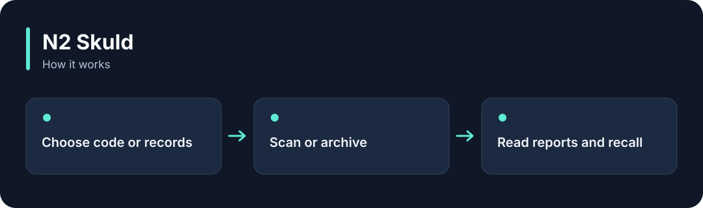

# N2 Skuld

**Find unfinished work in source code, and archive and recall older experience records.**

[](https://github.com/choihyunsus/n2-skuld/releases/tag/v1.0.0) [](https://github.com/choihyunsus/n2-skuld/blob/main/docs/reference.md) [](https://github.com/choihyunsus/n2-skuld/blob/main/LICENSE)

[한국어](README.ko.md)



## When to use it

Collect TODO and FIXME comments, or move older AI experience records into an archive.

Code scanning and archival are separate commands. Archival applies to the selected project and agent, so back up a real database before maintenance.

## Try it

Install Rust 1.98 or later and C/C++ build tools. On Windows, use Visual Studio C++ Build Tools. Then run this in a terminal.

```sh
cargo install --git https://github.com/choihyunsus/n2-skuld --tag v1.0.0 --locked
```

Choose a source folder. This first example reads unfinished-work markers in the files.

```sh
n2-skuld scan ./src --project demo --agent assistant
```

`report.complete: true` means the selected scan completed. Read `findings` for TODO and FIXME locations. The reference separately describes memory archival and recall.

## Using it with Soul

Point connected N2 modules at the same `mimir.db` file. `project` names the work and `agent` names the AI identity you will keep using. Match those values to continue working with the same records. Standalone use follows the same field layout.

## Next steps and reference

The [full reference](https://github.com/choihyunsus/n2-skuld/blob/main/docs/reference.md) covers app integration, APIs, supported features, recovery and validation. The [release page](https://github.com/choihyunsus/n2-skuld/releases/tag/v1.0.0) contains the installable version and release notes.

A few terms used in the reference: **MCP** connects tools to an AI app, a **database** stores records, and the **host** is the app that connects and runs this module.

Review the [license](https://github.com/choihyunsus/n2-skuld/blob/main/LICENSE) for use and redistribution. Dependencies can have their own terms, including commercial-use conditions described in the reference.
